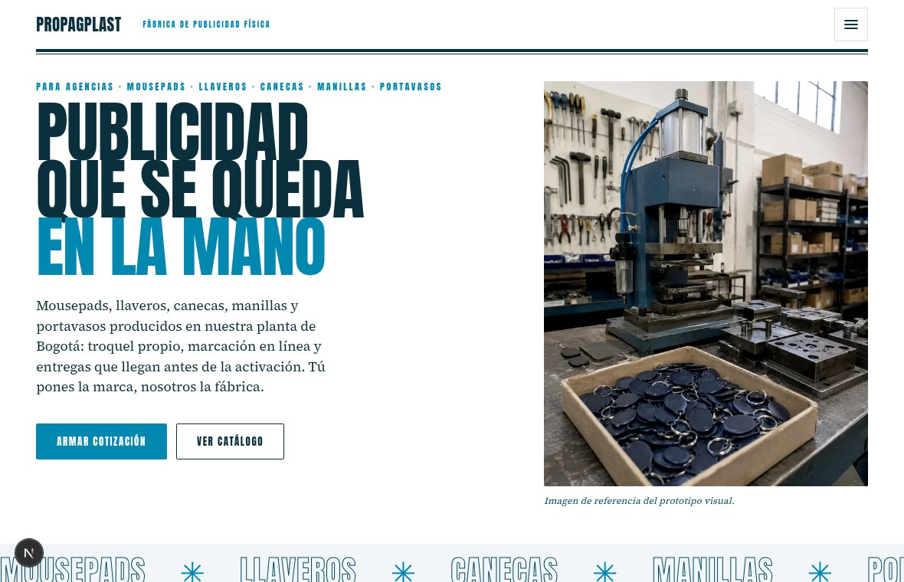
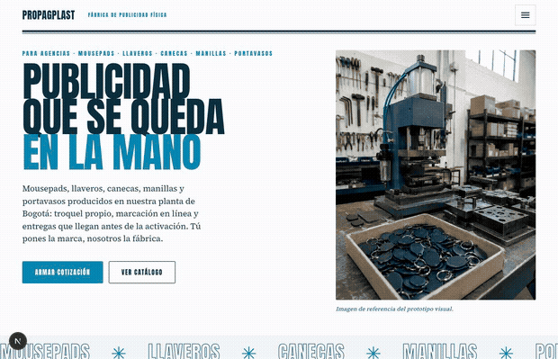
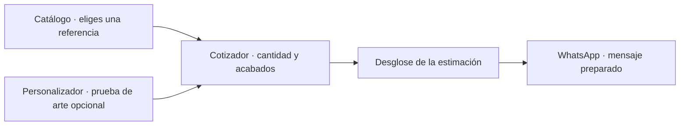

# Propagplast · Catálogo y cotizador

Una vitrina de productos promocionales para explorar formas de llavero, probar un logo sobre una referencia compatible y calcular una estimación por cantidad. El cliente puede continuar por WhatsApp con un resumen de su solicitud.


[Vista previa](#vista-previa) · [Inicio local](#ejecutar-el-proyecto)

## Vista previa

<a href="docs/media/portada.jpg"></a>

### De la galería al cotizador

El recorrido muestra cómo elegir una forma de llavero y llevarla a las observaciones de una estimación.

<a href="docs/media/recorrido.gif"></a>

## Flujo

```text
Landing → catálogo → detalle → personalización opcional → estimación → WhatsApp
```

- `/`: landing y selector de las cinco líneas Propagplast.
- `/catalogo`: catálogo local con filtros por línea.
- `/catalogo/[categorySlug]`: línea seleccionada y referencias aprobadas disponibles.
- `/producto/[slug]`: ficha del producto, imágenes, técnicas y mínimos.
- `/producto/[slug]/personalizar`: prueba de arte para referencias compatibles.
- `/cotizador?producto=[slug]`: configuración y cálculo local.

Los datos del formulario se utilizan exclusivamente para construir el mensaje. No se envían a un servidor ni se almacenan en el navegador.

## Del catálogo a la solicitud

La estimación y la prueba de arte se procesan en el navegador. Si el cliente descarga el PNG, puede adjuntarlo manualmente en WhatsApp.



## Ejecutar el proyecto

Requisitos: Node.js 20 o posterior y npm.

```bash
npm ci
cp .env.example .env.local
npm run dev
```

Abre [http://localhost:3000](http://localhost:3000).

Para comprobar una versión de producción:

```bash
npm run lint
npm run typecheck
npm test
npm run build
npm start
```

## Configuración

La única variable requerida para completar solicitudes es:

```env
NEXT_PUBLIC_WHATSAPP_NUMBER=573001234567
```

Usa el código del país y solo dígitos. Al generar el enlace, la aplicación también elimina automáticamente espacios, `+`, guiones y cualquier carácter no numérico.

## Editar el catálogo

La información está separada por responsabilidad:

- `src/data/products.ts`: productos, slugs, mínimos, imágenes y tramos de precio.
- `src/data/product-lines.ts`: fuente única de las cinco líneas, textos, SVG y enlaces.
- `src/data/categories.ts`: categorías derivadas de las líneas.
- `src/data/techniques.ts`: técnicas, preparación y precio por unidad.
- `src/data/additionals.ts`: adicionales y forma de cobro.
- `public/products/`: recursos visuales locales.
- `public/lines/`: ilustraciones SVG de las cinco líneas.

Las funciones `getAllActiveProducts`, `getProductBySlug` y `getProductsByCategory` evitan que la interfaz repita filtros sobre los arreglos.

### Agregar un producto

1. Confirma que pertenece a una de las cinco líneas de `product-lines.ts`; no agregues líneas sin aprobación comercial.
2. Agrega las técnicas y adicionales necesarios en sus respectivos archivos.
3. Guarda sus imágenes en `public/products/`.
4. Añade un objeto a `products.ts` con un `id` y `slug` únicos.
5. Comprueba que `categoryId`, `availableTechniqueIds` y `availableAdditionalIds` apunten a registros existentes.
6. Define `pricingType` y tramos coherentes. Para un precio que deba revisar un asesor usa `quote-only` y no agregues una cifra ficticia.
7. Ejecuta lint, TypeScript y build.

## Motor de cotización

`src/lib/quotation/` contiene funciones puras, independientes de React:

- `validate-quotation.ts`: valida cantidades y opciones disponibles.
- `get-price-tier.ts`: selecciona el tramo aplicable.
- `calculate-quote.ts`: calcula base, técnica, adicionales, costos fijos, IVA y total estimado.

El resultado conserva números sin formatear. El formato COP está centralizado en `src/lib/format.ts`.

Los productos `quote-only` devuelven un resultado explícito sin importes; la interfaz y el mensaje indican que el precio está pendiente de validación.

## WhatsApp

`src/lib/whatsapp/` valida y normaliza el número, compone el mensaje, lo codifica y construye la URL `https://wa.me/`. El cotizador abre el enlace con `noopener,noreferrer`.

El mensaje incluye:

- datos proporcionados por el solicitante;
- producto, cantidad, técnica y adicionales;
- desglose estimado o aviso de validación por asesor;
- advertencia de que el valor final puede variar.

## Despliegue

La aplicación puede desplegarse en cualquier plataforma compatible con Next.js 16:

1. configura `NEXT_PUBLIC_WHATSAPP_NUMBER` en el entorno de producción;
2. instala dependencias con `npm ci`;
3. genera el artefacto con `npm run build`;
4. inicia con `npm start`, o usa la integración nativa de la plataforma.

No es necesario aprovisionar base de datos, funciones, almacenamiento ni secretos de backend.
